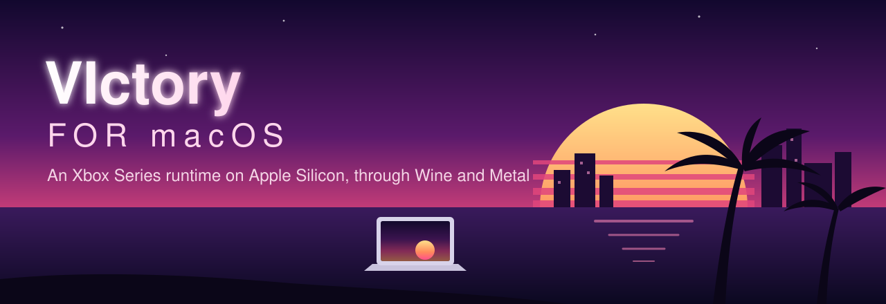
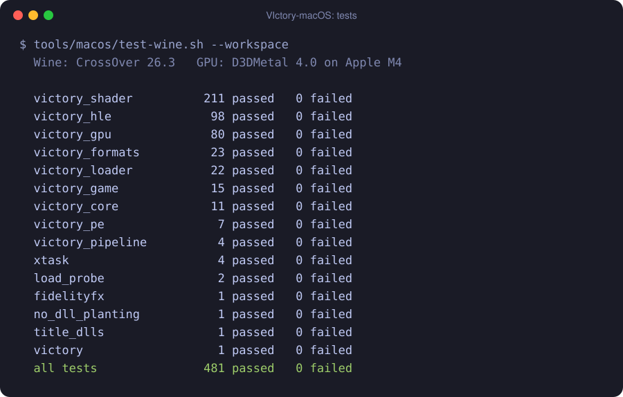

<p align="center"></p>

<h1 align="center">VIctory for macOS</h1>

<p align="center">
Grand Theft Auto VI is only out on consoles. This project runs the Xbox Series build on Apple Silicon Macs, from a copy of the game that you own.<br>
It is built on <a href="https://github.com/Marvisak/VIctory">VIctory</a>, which does the same on Windows, and it brings that work to the Mac through Wine and Metal.
</p>

<p align="center">


</p>

<p align="center">
If you want to see GTA VI on a Mac, please star the repo and read <a href="CONTRIBUTING.md">CONTRIBUTING.md</a>. Help is welcome at every level.
</p>

> [!IMPORTANT]
> **The game is not playable yet, on the Mac or anywhere else.** On testers' Macs the game starts, plays its intro and audio, shows its loading screens, and on 25 November the game world appeared on two Macs (#50). Nobody has reached gameplay yet: in the world the game runs at about 0.1 fps, because VIctory copies tens of gigabytes of memory per frame, and the setting that avoids those copies still freezes during loading. With `VICTORY_PATCH_MASKED=all VICTORY_FAULT_TRACKING=1`, loading now runs at about 26 to 30 fps instead of 8 (#59, #60). VIctory on Windows boots the game, runs its menus, loads the world and now draws it, but only at one or two seconds per frame and with unlit surfaces and missing geometry. This project makes the whole VIctory platform run on a Mac, so the Mac moves forward as VIctory does. No game files are included here or ever will be. You need your own copy of the game.

## What works today

Every part of VIctory now runs on an Apple Silicon Mac, and its full test suite passes on a MacBook with an M4 chip.

| Part | What it does | On the Mac |
| --- | --- | --- |
| Loader | Maps the game's executable and DLLs into one process and runs its code unchanged | Works |
| Console runtime | Stands in for the Xbox: memory, files, saves, input, audio and network rules | Works |
| GPU layer | Turns the console's Direct3D 12.X into desktop Direct3D 12 | Works on Metal through D3DMetal |
| Shader recompiler | Recompiles the console GPU's shaders, checked against the hardware's results | All 69 checks pass on Metal |
| Test suite | 711 tests across every crate | 701 passed, 0 failed, 10 ignored |

<p align="center"></p>

This is the real result of a clean run of `./setup.sh` followed by the test suite on a MacBook with an M4 chip.

Getting there took a few Mac-specific fixes, and each one is explained in [docs/macos.md](docs/macos.md). Two of them fixed real bugs that would have broken the picture on screen. Texture uploads were being skipped because Wine cannot see the memory that D3DMetal maps, and Metal's `sin` and `cos` return 0 where the console GPU returns NaN.

## What testers see in the game

Several people who own the game have run it on their Macs and reported back in the issues. The game starts, plays its audio and runs its menus, and on current main the picture shows on Series X. Here is what they have seen so far.

| Mac | What happened | Issue |
| --- | --- | --- |
| M5 MacBook Air | Got past the early Rosetta hang. The intro animation and the menu appeared with a local workaround that showed the game's 3840x2160 image directly, and the first scene's audio played. Without the workaround the window stays black. | #1, #15 |
| M5 Pro | With the Series S profile the game presented 64 frames of real drawing, all of them black, and then stopped on one of the game's own checks during start-up. Packages kept one per subfolder made it stop even earlier, and VIctory now says so at start-up. | #24 |
| M5 | At the Player prompt the game's 3840x2160 image held the picture while the 1920x1080 image sent to the window was black. | #15 |
| M2 Max | Account selection, the first setup screens with keyboard input, and the loading artwork all worked, and then the window went black. | #28 |
| M5 Pro, Series X | On 25 November, with no variables set, the game ran its intro and loading at 25 to 30 fps, then its draw count jumped to 3,000 to 3,900 per frame, which suggests it was drawing the world, though the screen stayed grey at 0.1 fps. A later run with `VICTORY_PATCH_MASKED=all` only went on into the world and drew a dark city skyline, still at 0.1 fps while it copied 57 to 83 GB of memory per frame. With the store patch and fault tracking on, copies stayed under a few MB per frame through loading, and it froze about three minutes in. That freeze led to #63. | #50 |
| M3 Max, Series X | On 25 November the picture showed with no workaround. The intro played and the game reached the "Vice City, two years ago" title card, where it froze while Apple's shader compiler kept crashing. A second run with a warm shader cache had no compiler crashes, but the window went black after the loading artwork. In a later run the game world appeared on screen before the game's own watchdog stopped it, with frames taking up to 28 seconds, most of it copying memory. With the store patch from #59 and #60 and fault tracking on, loading ran at 26 fps instead of 8 and copies fell from 158.7 MB to under 1 MB per frame, until a freeze about three minutes in. | #50 |

<p align="center"><br><sub>The title screen on jjlange's M3 Max, 25 November 2026 (#50).</sub></p>

<p align="center"><br><sub>The game world on jjlange's M3 Max, 25 November 2026 (#50).</sub></p>

<p align="center"><br><sub>Loading artwork on LakshanSivakumar's M5 Pro, 25 November 2026 (#50).</sub></p>

<p align="center"><br><sub>The game world on LakshanSivakumar's M5 Pro at 0.1 fps, 25 November 2026 (#50).</sub></p>

The black screen from #15 is solved: VIctory now shows the larger of the images the game presents, and `VICTORY_PRESENT_COMPOSITE=1` also draws the Series S overlay on top. Loading used to crawl because VIctory copied all of the game's memory on every submission, since tracking which pages changed hangs Rosetta on the game's AVX stores. #59 and #60 rewrite those 1,234 stores at load time so tracking can run. The open problems now are a freeze about three minutes into loading (#63 adds the texture read backs the game was likely waiting for, and testers are checking it), crashes in Apple's shader compiler while the game builds its world shaders, and the game's speed once the world loads.

## How it works

<p align="center"></p>

The Xbox Series version of the game is x86-64 code, like a Windows program. VIctory loads that code and supplies everything the console would have supplied. On a Mac, VIctory itself runs as a Windows program:

- **Rosetta 2** runs the x86-64 code, including the AVX2 instructions that the game uses.
- **CrossOver Wine** provides Windows. The setup builds it from the source that CodeWeavers publishes, because Apple's D3DMetal only works with that branch of Wine.
- **D3DMetal**, from Apple's Game Porting Toolkit, turns Direct3D 12 into Metal.

## Set it up in three steps

You need an Apple Silicon Mac (M1 or newer) on macOS 15 Sequoia or newer, [Homebrew](https://brew.sh), and about 15 GB of free space.

**1. Get the code.**

```bash
git clone https://github.com/pragyaangaur/VIctory-macOS.git
cd VIctory-macOS
```

**2. Download Apple's Game Porting Toolkit.** Apple only gives D3DMetal to signed-in developers, so this is the one step nobody can do for you. Open the [Apple developer downloads](https://developer.apple.com/download/all/?q=game%20porting%20toolkit), sign in with any Apple account (a free one works), and download the newest **Game Porting Toolkit** `.dmg`. Leave it in your Downloads folder and do not open it. Use version 4.0 beta 3 or newer. The D3DMetal 3.0 that CrossOver bundles runs the tests, but with it the game stops at one of its own start-up checks about seven seconds in, while the same game files get to the game world with 4.0 beta 3 (#24, #50).

**3. Run the setup.**

```bash
./setup.sh
```

The setup installs what it needs with Homebrew. It then builds the x86_64 libraries and CrossOver Wine, adds D3DMetal from the toolkit, and builds VIctory. The first run takes about an hour, almost all of it spent building Wine. If anything stops it, fix what it says and run it again, because finished steps are skipped.

When it says **Setup finished**, you can check that VIctory starts:

```bash
tools/macos/victory.sh config
```

## Running the game

Put your own copy of the Xbox Series build in a folder, set `game_dir` in `victory.toml` to that folder, and start it. Every package's files must sit directly in that folder, so `appdata0.rpf` is at `<game_dir>/appdata0.rpf` and not in an `appdata0` subfolder. With one subfolder per package the title asserts early at `+0x2237178`, and `victory` now stops before that and says which file is misplaced (#24).

```bash
tools/macos/victory.sh run --execute <the game's executable>
```

For now this gets as far as VIctory does on Windows, as the note at the top explains.

## Running the tests

These commands are useful for anyone who works on the code. The first runs the tests natively on the Mac, and the second runs them as Windows programs on Wine with D3DMetal, which includes the GPU tests.

```bash
cargo test --workspace
```

```bash
WINE="$HOME/Library/Caches/victory-macos/target/wine-cx/bin/wine" WINEDLLOVERRIDES="d3d12,d3d12core,dxgi=b" tools/macos/test-wine.sh --workspace --no-fail-fast
```

## Help test on your Mac

The project needs test results from as many Macs as possible. The [Mac test fleet](docs/fleet.md) runs both test suites on your Mac and reports the counts to this repository. It uses only the project's own tests, never a game. Paste this into an AI coding agent on your Mac, such as Claude Code, Codex or Cursor:

```text
Read https://raw.githubusercontent.com/pragyaangaur/VIctory-macOS/main/docs/fleet-join.md and follow it to help test VIctory on my Mac. Ask me before installing or posting anything.
```

Please read [docs/fleet-legal.md](docs/fleet-legal.md) first. You can also run the fleet by hand with `tools/fleet/fleet.sh`.

## Where things are

| Path | What it holds |
| --- | --- |
| `setup.sh` | The one-step setup |
| `tools/macos/` | The Wine build, the library build, the launcher and the test runner |
| `tools/fleet/` | The Mac test fleet: the worker, the issue queue and its tests ([docs/fleet.md](docs/fleet.md)) |
| `docs/macos.md` | The full story of the port, the problems found and how each was fixed |
| `crates/` | VIctory's runtime: loader, console runtime, GPU layer, shader recompiler and formats |
| `docs/architecture.md` | How VIctory itself is put together |

## Acknowledgement

This project is built on top of [VIctory](https://github.com/Marvisak/VIctory) by Marvisak. The loader, the console runtime, the GPU layer and the shader recompiler all come from VIctory, and its full history is kept in this repository. This project adds the macOS side: the Mac build, the Wine and D3DMetal setup, and the fixes that the Mac needed. VIctory is licensed under GPL-3.0, so this project is too.

Thanks also go to CodeWeavers for publishing CrossOver's source, to the Wine project, and to Apple for the Game Porting Toolkit.

## Legal

This project is not affiliated with or endorsed by Rockstar Games, Take-Two Interactive, Microsoft or Apple. Grand Theft Auto is a trademark of Take-Two Interactive. This repository contains no game files, keys or code from the game, and it never will. It only runs a copy that you own. D3DMetal is not included, and each user downloads it from Apple under Apple's terms.

The code is licensed under the [GNU General Public License v3.0](LICENSE).
